# HoloGrid

**A procedural sci-fi HUD generator for Windows.** HoloGrid renders a live, endlessly animated "mission control" dashboard — radar sweeps, orbiting nodes, 4D wireframes, synthwave horizons, falling code — entirely from code. No video files, no assets, no network: every pixel is generated frame by frame at a locked 60 fps.

## About

HoloGrid started as an attempt to recreate the look of futuristic movie interfaces — the dense, glowing data screens you see on a spaceship bridge or in a hacker's lair — as a real, running program instead of a pre-rendered clip. Every element is animated from smooth math (sine fields, easing, orbital mechanics), so the numbers, graphs and motion drift naturally instead of jittering at random.

It ships with **11 hand-built themes**. Each one has its own palette, its own centerpiece visualization, and its own vocabulary — titles, telemetry, callouts, log messages and panel layouts all change — so switching theme feels like opening a different film's control room, not just recoloring the same screen.

Built with Python and pygame, packaged as a single Windows executable.

## Themes

| # | Theme | Centerpiece |
|---|-------|-------------|
| 1 | **Neon** | Radar sweep with orbiting service nodes |
| 2 | **Paper** | The same radar on a light, print-style sheet |
| 3 | **Crimson** | Tactical targeting reticle with lock-on tracking |
| 4 | **Matrix** | Falling-code rain around a rotating core |
| 5 | **Aurora** | Flowing aurora ribbons over a planetary horizon |
| 6 | **Solar** | Orrery with planets, moons, trails and asteroid belt |
| 7 | **Abyss** | Deep-sea topographic contours with sonar pings |
| 8 | **Cyber** | Synthwave sunset and scrolling perspective grid |
| 9 | **Ice** | Rotating 4D tesseract with cryo rings |
| 10 | **Quantum** | Atom with electron orbits and a probability cloud |
| 11 | **Blueprint** | Meshing mechanical gears with dimension lines |

## Screenshots

| | |
|---|---|
| 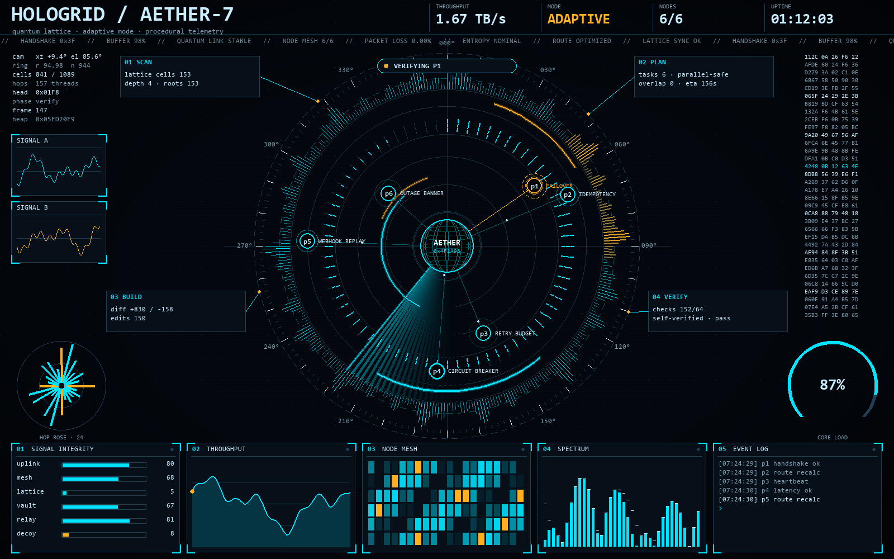 | 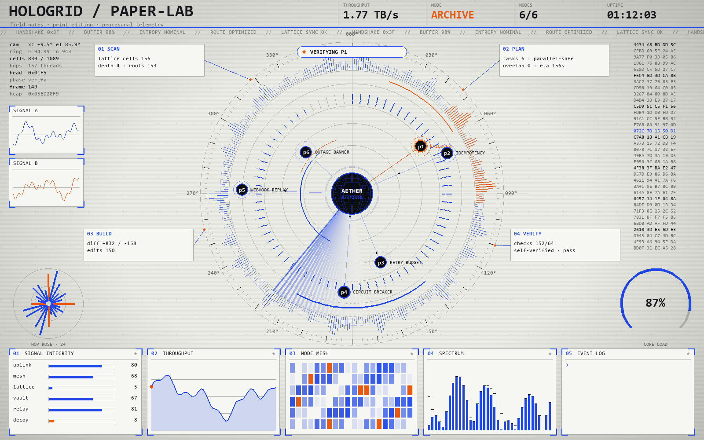 |
| 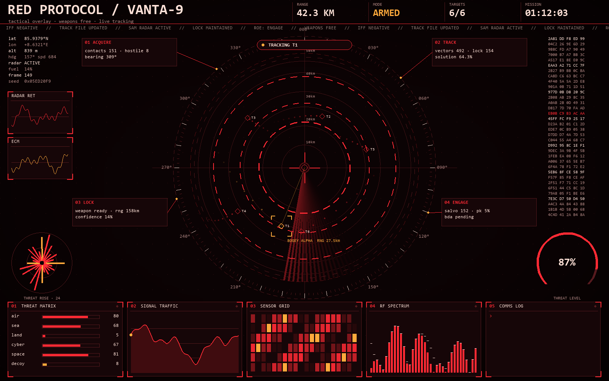 | 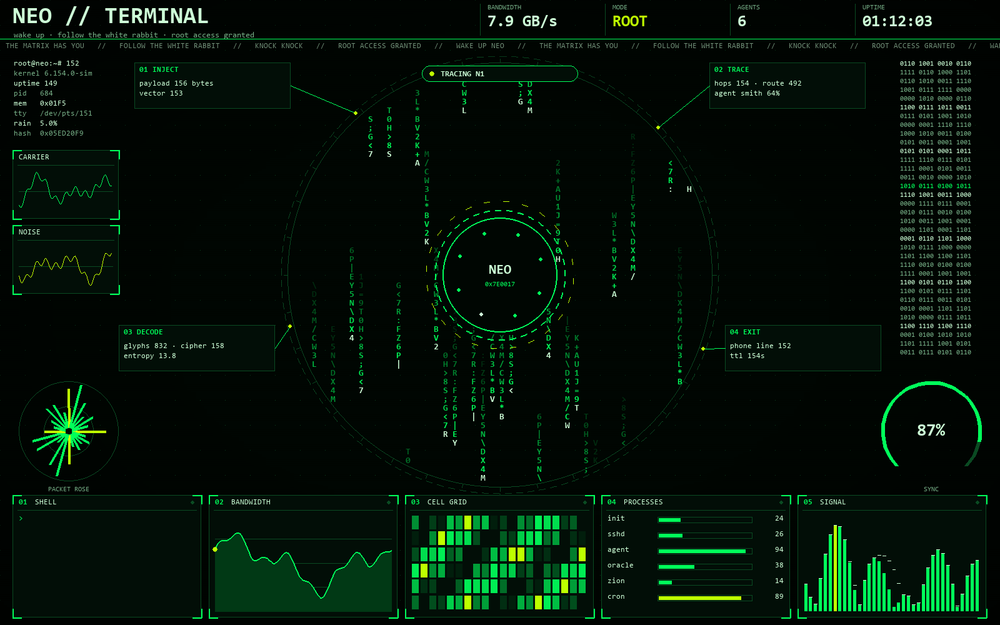 |
| 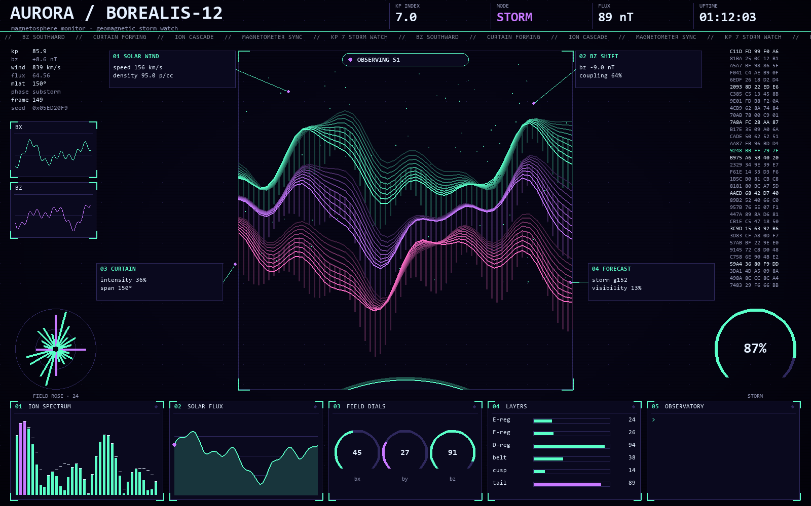 | 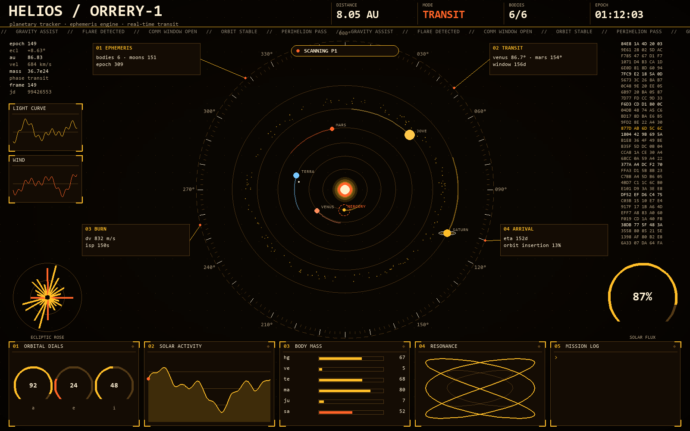 |
| 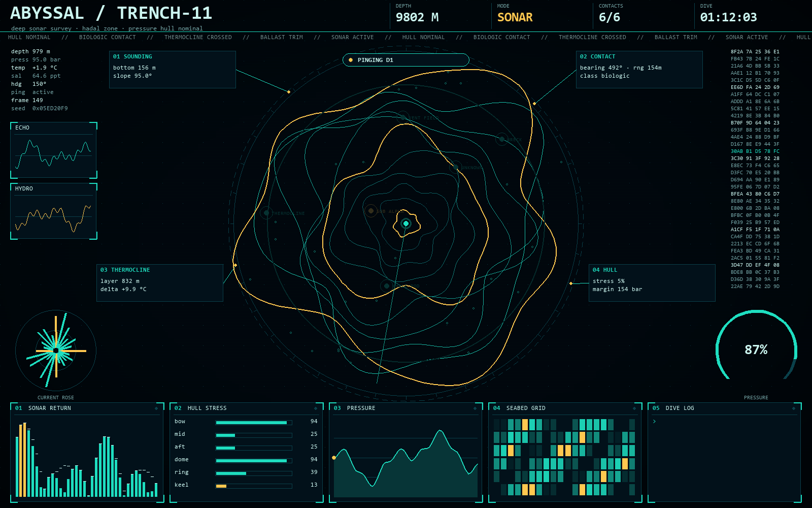 | 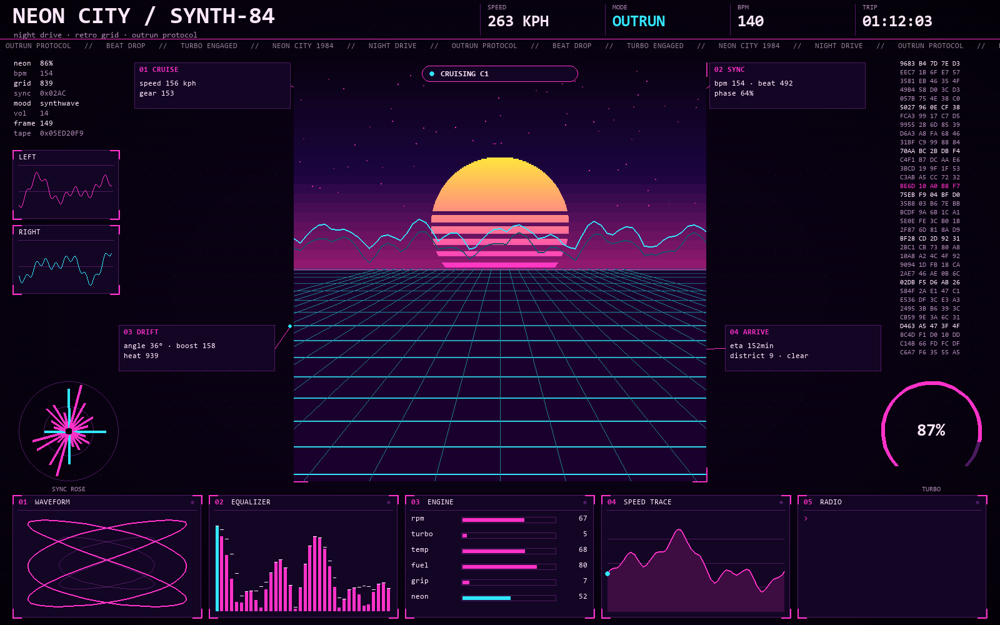 |
| 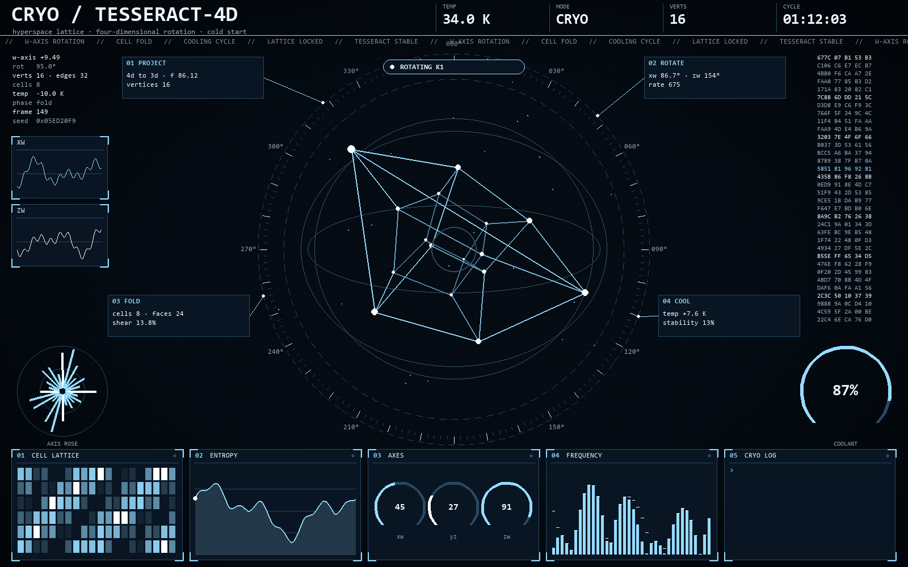 | 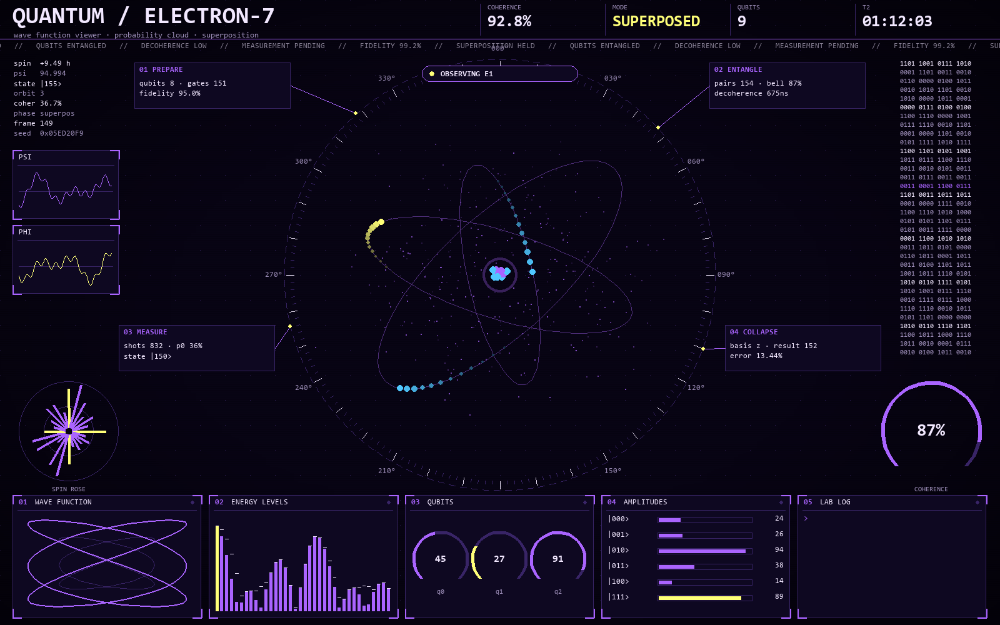 |
| 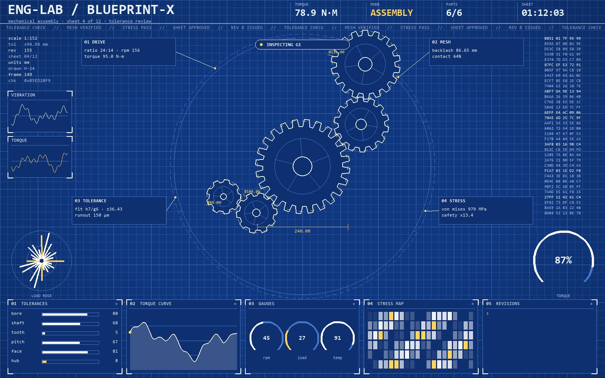 | |

## Install

Download **`HoloGrid-Setup.exe`** from the [latest release](../../releases/latest) and run it. It installs per-user (no admin rights needed), adds Start Menu and Desktop shortcuts, and registers an uninstaller under *Settings → Apps*. A portable `HoloGrid.exe` is also attached to each release.

> Windows SmartScreen may warn about an unsigned app. Choose *More info → Run anyway*.

## Controls

| Key | Action |
|-----|--------|
| `T` / `Shift+T` | Next / previous theme |
| `1`–`9`, `0`, `-` | Jump straight to theme 1–11 |
| `F11` | Fullscreen |
| `Space` | Pause |
| `S` | Save a screenshot to your Pictures folder |
| `Esc` | Quit |

## Run from source

```bash
pip install pygame
python hologrid.py
```

## Build

```bash
pip install pyinstaller
pyinstaller --onefile --noconsole --name HoloGrid hologrid.py
powershell -ExecutionPolicy Bypass -File installer/build-installer.ps1   # builds HoloGrid-Setup.exe with Windows' built-in IExpress
```
